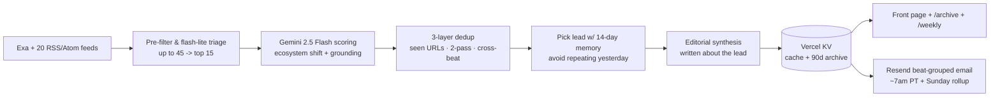

# 🛰️ Frontier AI Digest

**Every morning, an automated pipeline reads the AI frontier across all layers of the stack so you don't have to.**

[](https://frontier-ai-digest.vercel.app/)


A daily, automated intelligence digest tracking where value is shifting or accruing across frontier AI. It monitors 145+ tracked companies plus 20 primary-source RSS/Atom feeds across four beats, triages and scores stories for ecosystem impact, maintains cross-day lead memory and a 90-day archive, sends a beat-grouped morning briefing, and compiles a Sunday weekly synthesis.

👉 **Read today's:** [frontier-ai-digest.vercel.app](https://frontier-ai-digest.vercel.app/) · [Archive](https://frontier-ai-digest.vercel.app/archive) · [Weekly](https://frontier-ai-digest.vercel.app/weekly)

---

## The four beats

| Beat | What it watches |
|------|-----------------|
| 🤖 **Physical AI** | Robotics foundation models, humanoids, embodied agents |
| 🏗️ **AI Infrastructure** | Chips, inference, training stacks, the picks-and-shovels layer |
| 🧪 **AI Labs** | Frontier model releases, research, the labs themselves |
| 📊 **Vertical AI** | AI going deep into one industry at a time |

Each beat runs on its own cron, scores its own stories, and feeds one shared front page, archive, weekly rollup, and morning email.

## How a digest gets made



1. **Retrieve.** [Exa](https://exa.ai) neural queries plus 20 verified primary-source RSS/Atom feeds (`openai.com`, `deepmind.google`, `huggingface.co`, `blogs.nvidia.com`, `bostondynamics.com`, `waymo.com`, `stratechery.com`, `simonwillison.net`, etc.) pull breaking developments across each beat.
2. **Pre-filter & 2-stage triage.** Deterministic filters (`lib/filters.ts`) drop IR subdomains, periodic roundups, generic media-center pages, and excluded industries before `gemini-2.5-flash-lite` triages up to 45 candidates down to the top 15 for deep scoring.
3. **Score for stack shifts.** `gemini-2.5-flash` ranks each item on ecosystem value shifts across models, infrastructure, vertical apps, and robotics, with strict source grounding and a "So What?" linter.
4. **Dedup, three ways.** Exa/RSS normalized `seenUrls`, a two-pass URL + `storyId` collapse, and a cross-beat dedup pass at aggregation so the same story never shows up twice.
5. **Choose an unseen lead, then write about it.** `pickFeaturedArticle` excludes recent leads persisted in KV (`digest:recent-leads`) so consecutive days don't open with the same story, then Gemini writes the thesis and email subject about that exact lead.
6. **Cache, archive, & deliver.** Results land in Vercel KV (`digest:published` + `digest:archive:YYYY-MM-DD`), power `/`, `/archive`, and `/weekly`, and send a beat-grouped "So What?" morning email (plus a Sunday weekly synthesis) via [Resend](https://resend.com).

## Built to survive a bad API day

The interesting engineering here is in the failure modes, not the happy path:

- **503 resilience + ops alerts.** Heavy Gemini Flash models throw intermittent "high demand" 503s. Scoring retries with escalating backoff, falls back to `gemini-2.5-flash-lite` (with valid thinking budget), and fires a rate-limited ops alert (`lib/alerts.ts`) on fallback or total failure.
- **Untrusted by default.** Web and RSS text is treated as a prompt-injection vector: sanitized, wrapped in unguessable fences, kept out of `systemInstruction`, and verified with `http(s)` URL guards.
- **No silent data loss.** If a beat refresh fails outright, it preserves the existing KV cache, re-throws so Vercel logs an HTTP 500 failure, and surfaces stale beats on `/api/health` and in the email header.
- **Edge-proxied logos & self-hosted fonts.** Company logos serve through `/api/logo/[domain]` so `LOGO_DEV_KEY` stays server-side, and Playfair Display + DM Sans are self-hosted via `next/font/local`.

## Stack

`Next.js` (App Router) · `TypeScript` · `Tailwind` · `@google/genai` (Gemini) · `exa-js` · `Resend` · `@vercel/kv` · `zod` · deployed on `Vercel` with cron + analytics.

## Running it yourself

```bash
npm install
npm run dev              # http://localhost:3000
npm test                 # node --test across the pipeline
npm run build            # production build
npm run eval -- --live   # offline quality scorecard against live production
npm run eval:models      # blind A/B across <$1/mo OpenRouter or Gemini models
```

Environment (`.env.local`):

| Var | Purpose |
|-----|---------|
| `OPENROUTER_API_KEY` | Optional unified router key (enables 3-slot cross-vendor routing + fallback) |
| `OPENROUTER_TRIAGE_MODEL` | Slot 1 (`45 -> 15` triage, default `deepseek/deepseek-v4.1-flash:floor`) |
| `OPENROUTER_SCORING_MODEL` | Slot 2 (15-item scoring + "So What?", default `openai/gpt-5.4-nano:floor`) |
| `OPENROUTER_SCORING_FALLBACKS` | Comma-separated Slot 2 fallbacks (`gpt-5.6-luna:floor`, `deepseek-v4.1-flash:floor`, `gemini-3.5-flash-lite`) |
| `OPENROUTER_SYNTHESIS_MODEL` | Slot 3 (daily thesis + weekly rollup, default `google/gemini-4-hydrogen:floor`) |
| `GOOGLE_API_KEY` | Fallback/direct Gemini scoring when `OPENROUTER_API_KEY` is unset |
| `GOOGLE_API_KEY_SYNTHESIS` | Fallback/direct Gemini synthesis when `OPENROUTER_API_KEY` is unset |
| `EXA_API_KEY` | Retrieval |
| `RESEND_API_KEY` | Daily briefing, weekly rollup & ops alerts |
| `LOGO_DEV_KEY` | Company logo proxy (`/api/logo/[domain]`) |
| `CRON_SECRET` | Guards cron and admin routes (constant-time Bearer check) |
| `KV_*` | Vercel KV cache & archive (auto-injected on Vercel) |

### The cron schedule

Defined in [`vercel.json`](vercel.json): beats refresh overnight Pacific time (`10:00-13:00 UTC`, avoiding DeepSeek peak hours and tapping Flex capacity troughs), the morning digest publishes at `14:00 UTC` (~6-7am PT), and Sunday runs refresh the logo map and compile the weekly rollup.

```
10:00 UTC  Physical AI        12:00 UTC  AI Labs
11:00 UTC  AI Infrastructure  13:00 UTC  Vertical AI
14:00 UTC  send daily digest ✉️
Sun 01:00 UTC  prefetch company logos
Sun 15:00 UTC  weekly rollup + email ✉️
```

## Repo map

```
app/page.tsx               homepage (New/Earlier filter, search, lead + beats)
app/archive/               90-day daily edition archive (/archive & /archive/[date])
app/weekly/                Sunday cross-stack weekly rollup (/weekly)
app/api/beat               per-beat retrieve (Exa + RSS) + triage + score + cache
app/api/digest             aggregate cached beats on demand
app/api/send-digest        publish to KV + archive + send morning briefing
app/api/weekly-digest      synthesize & email Sunday weekly rollup
app/api/logo/[domain]      server-side Logo.dev proxy
app/api/health             public beat freshness + published digest status
lib/exa.ts                 Exa retrieval & URL normalization
lib/rss.ts                 20 primary-source RSS/Atom feeds & XML parser
lib/filters.ts             deterministic noise/industry filter & So What linter
lib/summarize.ts           2-stage triage, scoring, dedup, synthesis, resilience
lib/llm.ts                 3-slot OpenRouter client (triage / scoring / synthesis)
lib/beat-digests.ts        KV orchestration, cross-day lead memory, daily archive
lib/weekly.ts              Sunday weekly synthesis & Outlook-safe email builder
lib/alerts.ts              rate-limited Resend ops alerts
lib/companies.ts           145+ tracked companies + canonical tag resolver
lib/email.ts               beat-grouped Outlook-safe morning briefing builder
scripts/eval-digest.ts     offline & --live quality scorecard
scripts/model-ab.ts        blind multi-beat <$1/mo model A/B harness
__tests__/                 pipeline, resilience, filter, RSS, email & auth tests
```

---

<sub>A personal project by [@madfreakz](https://github.com/madfreakz). Built in the open, run on a budget of about 16 cents a beat. ☕</sub>
